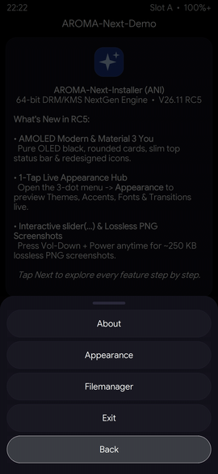
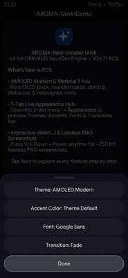
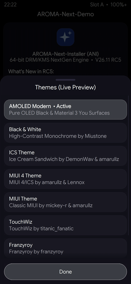
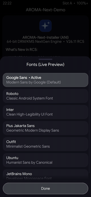
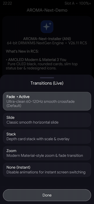
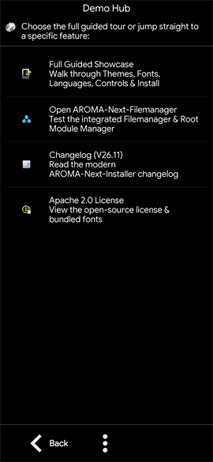
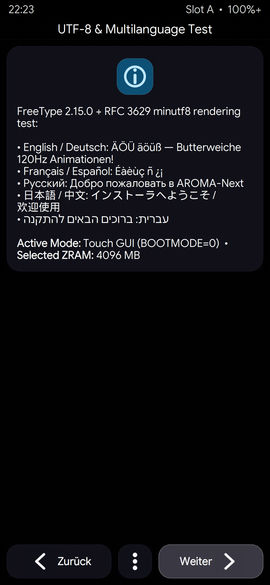

<div align="center">

# AROMA-Next-Installer

**Classic Touch-GUI Android Installer & Integrated Filemanager — Rebuilt for Modern `arm64-v8a` & `armeabi-v7a` Devices, Custom Recoveries, and Systemless-First Magisk / KernelSU / APatch Modules**

[](https://github.com/Miustone/AROMA-Next-Installer/actions/workflows/build.yml)
[](https://github.com/Miustone/AROMA-Next-Installer/releases)
[](https://github.com/Miustone/AROMA-Next-Installer/releases)
[](#downloads--which-zip-should-i-use)
[](LICENSE)

[Screenshots](#screenshots) • [Highlights](#highlights) • [Wiki & Developer Guide](WIKI.md) • [Downloads & ZIP Guide](#downloads--which-zip-should-i-use) • [Filemanager](#aroma-next-filemanager--root-module-manager) • [Systemless Modding](#systemless-first-modding--optional-pre-rw) • [Building](#building-from-source) • [Changelog](CHANGELOG.md)

</div>

---

**AROMA-Next-Installer** is a modern `arm64-v8a` + `armeabi-v7a` revival of Ahmad Amarullah's **AROMA Installer** (Apache 2.0). Rebuilt for contemporary Android smartphones (Android 10–16+), modern custom recoveries (**TWRP**, **OrangeFox**, **AERA Recovery**, **PitchBlack**), and safe **Systemless-First** module packaging (**Magisk**, **KernelSU**, **APatch**) — now shipping with **Google Sans** typography, **60–120Hz+ smooth Transitions**, and a fully integrated **AROMA-Next-Filemanager & Root Module Manager**.

---

## Screenshots

<p align="center">
  <em>Captured on Google Pixel 7 Pro • OrangeFox R12.0 • Black &amp; White Theme + Google Sans Default — Click any screenshot for full QHD+ resolution</em>
</p>

<div align="center">
  <table>
    <tr>
      <td align="center">
        <a href="screenshots/01-welcome.png">
          
        </a><br>
        <sub><b>1. Welcome &amp; Engine Highlights</b></sub>
      </td>
      <td align="center">
        <a href="screenshots/02-3dot-menu.png">
          
        </a><br>
        <sub><b>2. Streamlined 3-Dot Menu</b></sub>
      </td>
      <td align="center">
        <a href="screenshots/03-about-dialog.png">
          
        </a><br>
        <sub><b>3. About Dialog (V26.11)</b></sub>
      </td>
    </tr>
    <tr>
      <td align="center">
        <a href="screenshots/04-themes-submenu.png">
          
        </a><br>
        <sub><b>4. Themes Submenu</b></sub>
      </td>
      <td align="center">
        <a href="screenshots/05-select-theme.png">
          
        </a><br>
        <sub><b>5. Live Theme Switcher</b></sub>
      </td>
      <td align="center">
        <a href="screenshots/06-select-font.png">
          
        </a><br>
        <sub><b>6. Live Font Switcher (7 Fonts)</b></sub>
      </td>
    </tr>
    <tr>
      <td align="center">
        <a href="screenshots/07-transitions.png">
          
        </a><br>
        <sub><b>7. Smooth Transitions (Fade Default)</b></sub>
      </td>
      <td align="center">
        <a href="screenshots/08-demo-hub.png">
          
        </a><br>
        <sub><b>8. Interactive Demo Hub</b></sub>
      </td>
      <td align="center">
        <a href="screenshots/09-multilanguage-utf8.png">
          
        </a><br>
        <sub><b>9. Full UTF-8 &amp; Multilanguage</b></sub>
      </td>
    </tr>
  </table>
</div>

---

## Highlights

- **Modern Display Engine (`DRM/KMS` + `fbdev`) & Smooth 60–120Hz+ Transitions:** Pure Linux kernel ioctl **Atomic KMS** ping-pong double-buffered engine (zero `libdrm.so` dependency) with single-pass ARM NEON RGB565→RGBA backbuffer blitting, VSYNC-locked time-based cubic ease-out transitions (**`Fade` Default**, **`Slide`**, **`Stack`**, **`Zoom`**, and **`None`**), Exynos/Google Tensor panels (`RGBA8888`), **Qualcomm `msm_drm` Dual-LM Source-Split (AERA Recovery)**, legacy `SETCRTC` + `DIRTYFB`, and `fbdev` fallback.
- **Google Sans Default + 7 Bundled Open-Source Fonts:** Ships with official open-source **Google Sans** (SIL OFL) as the default typeface across every ZIP, paired with **Roboto**, **Inter**, **Plus Jakarta Sans**, **Outfit**, **Ubuntu**, **JetBrains Mono**, and `DroidSansFallback.ttf` for full Latin, Cyrillic, Hebrew, and CJK UTF-8 rendering.
- **Streamlined 3-Dot Menu & Dedicated `Themes` Hub:** Clean top-to-bottom menu (**`About` → `Themes` → `Filemanager` → `Exit` → `Back`**). Tap **`Themes`** at any screen to switch **Themes** (*Black & White, ICS, MIUI 4, MIUI, Touchwiz, Franzyroy, Generic*), **Fonts** (*7 modern fonts*), or **Transitions** (*Fade, Slide, Stack, Zoom, None*) live without restarting or losing selections.
- **Integrated `AROMA-Next-Filemanager` & Root Module Manager:** Built directly into the shared AROMA-Next binary (zero duplicate engine code) — launchable from **3-Dot Menu → `Filemanager`** inside any installer OR standalone via **`AROMA-Next-Filemanager.zip`**.
- **Modern HiDPI Splash & Nostalgia Animation:** Crisp 920×360 HiDPI **AROMA-Next-Installer** Google Sans splash screen featuring the classic AROMA echo-pulse nostalgia animation with automatic proportional HiDPI scaling.
- **Modernized 2026 Core Libraries:** Upgraded all vendored C libraries from 2011/2012 baselines to **`zlib 1.4`**, **`libpng 1.6.59`** (ARM64/ARM32 NEON intrinsics), **`FreeType 2.15.0`** (Subpixel LCD filtering & Variable Fonts), and a rewritten RFC 3629-compliant **`minutf8`** UTF-8 decoder.
- **Zero-Freeze Recovery Safety (`EXIT 77` + Crash Guards) & High-Hz OLED Touch:** Scans `/dev/input/event0..63`, supports Linux Multitouch Protocol Type-B (`ABS_MT_SLOT`), captures thread-safe `.bmp` screenshots via `Vol-Down + Power` (with shutter flash), protects ancestor recovery processes with async-signal-safe `SIGCONT` crash guards, and switches seamlessly to Volume Key mode (`EXIT 77`) if a recovery holds an unshared display lock.
- **Single-Config Dual-Mode Engine (`BOOTMODE=0` Touch GUI + `BOOTMODE=1` Native Volume Key Selector):** Module authors write **only ONE `aroma-config`** (zero MMT-Extended, zero duplicate scripts!) — AROMA-Next automatically renders the full **60–120Hz Touch GUI** in Custom Recovery (`BOOTMODE=0`) and switches to its built-in **native C Volume Key Selector** (with 48-column UTF-8 word-wrapping & `/dev/input` hardware key reading) when flashed inside the **Magisk**, **KernelSU**, or **APatch** app (`BOOTMODE=1`). See [Miustone/NLSound](https://github.com/Miustone/NLSound) for a live real-world showcase and read the full [WIKI.md](WIKI.md)!

---

## Downloads — Which ZIP Should I Use?

Every GitHub Release on the [**Releases**](https://github.com/Miustone/AROMA-Next-Installer/releases) page ships **4 purpose-built flashable ZIPs** plus standalone static ELF binaries, all sharing the exact same `arm64-v8a` + `armeabi-v7a` engine:

| Package | Best For | What's Inside |
| :--- | :--- | :--- |
| **`AROMA-Next-Installer.zip`** | **ROM / Kernel / Mod Developers** (Clean Base Template) | Minimal, clutter-free starter installer with the modern HiDPI nostalgia splash, Google Sans + Black & White defaults, clean Welcome screen, quick Filemanager entry, and a safe sample `updater-script`. Ready to customize without legacy 2013 demo clutter. |
| **`AROMA-Next-Magisk-Template.zip`** | **Magisk / KernelSU / APatch Module Authors** | Ready-to-use **Systemless-First** (+ optional Pre-RW) Dual-Mode module template: **ONE `aroma-config`** automatically drives both the Recovery Touch GUI (`BOOTMODE=0`) and AROMA-Next's built-in **native Volume Key Selector** (`BOOTMODE=1` in Magisk / KSU / APatch apps) via `aroma_run_config_if_needed` — zero MMT-Extended required! |
| **`AROMA-Next-Filemanager.zip`** | **End Users & Power Users** (Recovery Tool) | Standalone flashable **AROMA-Next-Filemanager & Root Module Manager** — boots directly into the file & module manager (also accessible from the 3-Dot Menu inside every other AROMA-Next ZIP). |
| **`AROMA-Next-Demo.zip`** | **Testers & Explorers** (Full Feature Showcase) | Interactive showcase of **every** AROMA-Next V26.11 feature on demand: Splash + Nostalgia Animation, all 7 Themes, all 7 Fonts, all 5 Transitions, Multilanguage UTF-8 test, Checkboxes, Forms, Menubox, modern V26.11 Changelog, Apache 2.0 License, Filemanager launch, and simulated install progress. |
| **`aroma_installer-arm64`** / **`aroma_installer-arm32`** | **Custom Integrations** | Standalone static musl/NDK ELF binaries (`arm64-v8a` & `armeabi-v7a`). |

### Supported & Verified Recoveries / Devices

| Device | Recovery | Display Backend | Supported Since |
| :--- | :--- | :--- | :--- |
| **Google Pixel 7 Pro** (`cheetah`, Android 16) | OrangeFox R12.0 | `exynos-drm` (Atomic KMS) | `V26.11-RC1` (2026-11-19) |
| **OnePlus 15** *(+ other Qualcomm `msm_drm` devices)* | **AERA Recovery** | Qualcomm `msm_drm` (Dual-LM Source-Split + High-FD `OUTFD >= 10`) | [`V26.11-RC2-PRE2`](CHANGELOG.md#v2611-rc2-pre2--2026-11-20-pre-release) *(2026-11-20 Pre-Release)* |

> **AERA Recovery Support (`V26.11-RC2-PRE2` — 2026-11-20 Pre-Release):** Includes Qualcomm `msm_drm` Dual-LM Source-Split Atomic KMS plane prioritization, pixel-format validation, full primary + overlay plane restoration on exit, and `/proc/self/fd/$OUTFD` high-FD pipe compatibility.
>
> Have you tested AROMA-Next on another device or recovery? Feedback and `/tmp/recovery.log` reports are always welcome via GitHub Issues!

---

## AROMA-Next-Filemanager & Root Module Manager

Integrated directly into the shared C engine (`src/main/aroma_filemanager.c`) with 4 unified **inline top tabs** (**`Modules` | `Storage` | `System` | `Tools`**) and a 1:1 matched installer bottom navigation bar:

- **Root Module Manager (`Modules` → `/data/adb/modules`):**
  - Lists all installed **Magisk**, **KernelSU**, and **APatch** modules with metadata (`module.prop`) and live status (`ACTIVE`, `DISABLED`, `REMOVE PENDING`, `UPDATE PENDING`).
  - One-tap **Enable / Disable**, **Mark for Removal on Reboot**, **Delete Module Now**, **Browse Module Files**, **Edit `module.prop`**, and **Edit `system.prop`**.
- **Internal Storage (`Storage` → `/sdcard` / `/data/media/0`):**
  - Recursive **Copy**, **Cut / Move**, **Paste**, **Delete**, **Rename**, **New Folder**, **New Text File**, **`chmod`** (presets & custom octal), **Properties**, and hidden `.dotfiles` toggle.
- **System Partitions (`System`):**
  - Inline browser for `/`, `/system`, `/system_root`, `/vendor`, `/product`, `/system_ext`, `/odm`, `/data`, `/cache`, `/persist`, `/metadata`, and `/tmp` with live `/proc/mounts` **`[RW]` / `[RO]`** + filesystem detection and a safe **`Remount Partition RW`** helper.
- **Built-in Touch Keyboard & Text Line Editor:**
  - Full on-screen QWERTY keyboard (lowercase, uppercase, symbols, UTF-8 backspace) and built-in **Text Viewer & Line Editor** (up to 256 KB with automatic binary file protection).
- **Edify Integration:** Any custom `aroma-config` can launch the file manager directly via `filemanager();` or `filemanager("/data/adb/modules");`.

---

## Systemless-First Modding + Optional Pre-RW

On modern Android (10–16+), `/system`, `/vendor`, `/product`, and `/system_ext` typically use **EROFS** (read-only by kernel design) or deduplicated `shared_blocks` `ext4` inside dynamic `super` partitions protected by `dm-verity`.

**AROMA-Next** brings back classic Touch-GUI file modding safely in two modes:

1. **Systemless Overlay Mode (Default & Recommended):**
   - Generates a standard Magisk / KernelSU / APatch module (`$MODPATH`, or directly `/data/adb/modules/<id>` when flashed in Recovery).
   - Works on **EROFS**, `shared_blocks` `ext4`, Virtual A/B, and active `dm-verity` with zero bootloop risk.
2. **Direct Partition RW Mode (Optional for Power Users):**
   - Intended **only** if you already converted your partitions to RW beforehand using an external tool like **RO2RW** or **SystemRW** and rebooted prior to running AROMA-Next.
   - `aroma_probe_rw()` verifies actual partition writability before touching anything; if partitions are still EROFS or locked RO, it safely falls back to Systemless Mode (or aborts cleanly).

### Dual-Mode Flow (`BOOTMODE=0` Recovery vs. `BOOTMODE=1` Android App)

- **In Custom Recovery (`TWRP` / `OrangeFox` / `AERA`, `BOOTMODE=0`):** `update-binary` detects `uname -m` (`aarch64` / `armv7l`), launches the **60–120Hz Touch GUI** (`aroma-config`), writes user choices to `/tmp/aroma/*.prop`, and calls `magisk-installer` → `customize.sh` (streaming real-time `aroma_progress` updates into AROMA's progress bar).
- **In Magisk / KernelSU / APatch App (`BOOTMODE=1`):** Android's SurfaceFlinger owns the display, so `aroma_run_config_if_needed` automatically launches AROMA-Next's built-in **native C Volume Key Selector** (`--volkey --config-only`) on the **exact same `aroma-config`** — rendering every `viewbox`, `menubox`, `selectbox`, `checkbox`, and `form` with 48-column UTF-8 word-wrapping and writing identical `$AROMA_TMP/*.prop` files!
- **On Locked Recovery Displays (`EXIT 77`):** `update-binary` catches exit code `77` and launches `aroma_installer --volkey` automatically — zero freezes and zero lost options.

### Developer Quickstart (`aroma-mod-lib.sh`)

Use `magisk-template/` as your starting point (see the full [**WIKI.md**](WIKI.md) for every Edify widget, CLI flag, and ROM/Module walkthrough, plus **[Miustone/NLSound](https://github.com/Miustone/NLSound)** as a live real-world module showcase). Inside `customize.sh`, source `aroma-mod-lib.sh`:

```sh
# 0. In BOOTMODE=1 (Magisk / KSU / APatch App), automatically run aroma-config via Volume Keys!
aroma_run_config_if_needed

# 1. Initialize backend ("systemless", "rw", or "auto"; 3rd arg = fallback to systemless 1|0)
aroma_mod_init "$REQ_MODE" "$MODPATH" 1

# 2. Set/override build.prop entries (writes $MODPATH/system.prop in Systemless mode)
aroma_mod_edit_prop "ro.config.media_vol_steps" "30"

# 3. Copy/replace files into system, vendor, product, system_ext, or odm
aroma_mod_copy "$MODPATH/files/custom_config.example" "system/etc/custom_config.conf" 0644

# 4. Debloat / delete apps or files (.replace / KernelSU 0:0 whiteouts in Systemless mode)
aroma_mod_delete "system/app/ExampleBloat" "dir"
aroma_mod_delete "system/media/bootanimation.zip" "file"

# 5. Patch an existing read-only system file inside the overlay module
aroma_mod_patch_file "system/etc/hosts" "s/old_entry/new_entry/"
```

---

## Technical Architecture

<details>
<summary><b>Why Legacy AROMA Broke &amp; Under-the-Hood Improvements (Click to expand)</b></summary>

1. **64-bit (`arm64-v8a`) & C11 Cleanliness:**
   - Fixed 64-bit pointer truncation (`uintptr_t` in `src/libs/aroma_memory.c`, `intptr_t` casts in `src/libs/aroma_graph.c` and `libs/minzip/Zip.c`), `sizeof(AARRAY_ITEM)` allocation & `NULL`-key checks in `src/libs/aroma_array.c`, `0755` permissions in `src/libs/aroma_zip.c`, `fabs()` in `src/libs/aroma_libs.c`, ARM64 NEON blitter alpha init in `src/libs/neon/blt_neon.c`, destination bounds clipping in `ag_draw_strecth_ex`, and C11 inline linkage in `libs/minzip/inline_magic.h`.
   - Updated `Android.mk` + added `Application.mk` (`APP_PLATFORM := android-35`) for Android NDK r27c (`arm64-v8a` + `armeabi-v7a`).

2. **Dual Display Engine (`fbdev` + Pure-ioctl `DRM/KMS` + Atomic KMS):**
   - Added `src/libs/graph_drm.c`: pure Linux kernel ioctl DRM/KMS dumb-buffer backend (`/dev/dri/card0..3`) with **inherited DRM master FD detection** (`/proc/self/fd`), **Atomic KMS** double-buffering & overlay plane management (`DRM_IOCTL_MODE_ATOMIC`), direct single-pass ARM NEON backbuffer blitting, **Qualcomm `msm_drm` Dual-LM Source-Split** plane selection & full property restoration before `RMFB`, Exynos/Google Tensor byte-order handling (`RGBA8888`), legacy `SETCRTC` + `DIRTYFB` fallback, and zero external `libdrm.so` dependency.
   - Enhanced `fbdev` in `src/libs/aroma_graph.c`: tries `/dev/graphics/fb0` and `/dev/fb0`, validates `mmap != MAP_FAILED`, and reads real `red/green/blue/transp` channel offsets from `FBIOGET_VSCREENINFO`.
   - **Anti-Freeze Recovery Safety (`EXIT 77`):** If neither `fbdev` nor DRM master can be acquired, AROMA-Next immediately resumes the parent recovery (`SIGCONT`) and exits with code `77` (`AROMA_EXIT_NO_DISPLAY`) so the dispatcher runs the non-GUI fallback instead of hanging recovery.
   - **Process Hierarchy Pause (`src/main/aroma.c`):** Walks ancestor PIDs up to `recovery`/`twrp` so both shell dispatchers (`update-binary`) and the recovery compositor stay paused during Touch GUI execution and resume cleanly in reverse order.

3. **Modern Touch, Input & Recovery Pipe Compatibility:**
   - Raised `INDR_MAXDEV` from `15` to `64` so touchscreens on `/dev/input/event15+` are detected.
   - Added Linux Multitouch Protocol Type-B (`ABS_MT_SLOT`) filtering so secondary fingers don't corrupt slot-0 coordinates.
   - Replaced shared `static` touch globals with per-device state in `INDR_POS`, added `BTN_TOUCH` up handling, fixed `(1U << 31)` shift, added `ABS_X`/`ABS_Y` calibration fallback, and added `/sys/class/leds/vibrator/{duration,activate}` haptic fallback.
   - High File Descriptor (`OUTFD >= 10`) compatibility via `/proc/self/fd/$OUTFD` in `update-binary` and `magisk-installer`, plus dynamic `mount`/`umount` lookup in `src/main/aroma_ui.c`.

</details>

---

## Building from Source

### Option 1: GitHub Actions (Automatic Releases)
Push to `main`/`master` or push a tag `v*` / `V*` (creates a versioned GitHub Release; tags containing `-PRE` or `-TEST` are automatically marked as pre-releases) using [`.github/workflows/build.yml`](.github/workflows/build.yml) with Android NDK r27c.

### Option 2: Local Android NDK
```sh
ndk-build NDK_PROJECT_PATH=. APP_BUILD_SCRIPT=Android.mk NDK_APPLICATION_MK=Application.mk -j4
```

### Option 3: Local Cross-Compile with Zig (`zig cc`)
```sh
python build.py --arch arm64 arm32
```
Outputs static binaries to `out/bin/` and all 4 flashable ZIPs to `dist/` (`AROMA-Next-Installer.zip`, `AROMA-Next-Magisk-Template.zip`, `AROMA-Next-Filemanager.zip`, and `AROMA-Next-Demo.zip`).

---

## License & Credits

Licensed under the **Apache License 2.0** (see [LICENSE](LICENSE)). See [CHANGELOG.md](CHANGELOG.md) for the full release history.

- **2013** Ahmad Amarullah (`amarullz`) — Original AROMA Installer ([amarullz/AROMA-Installer](https://github.com/amarullz/AROMA-Installer))
- **2026** Miustone (`AROMA-Next-Installer`) — Support: Miustone (XDA & GitHub: [Miustone/AROMA-Next-Installer](https://github.com/Miustone/AROMA-Next-Installer))
