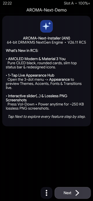
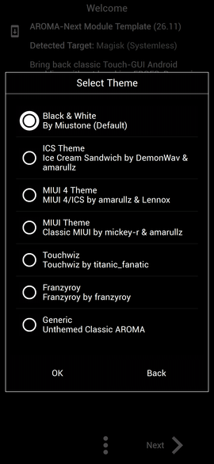
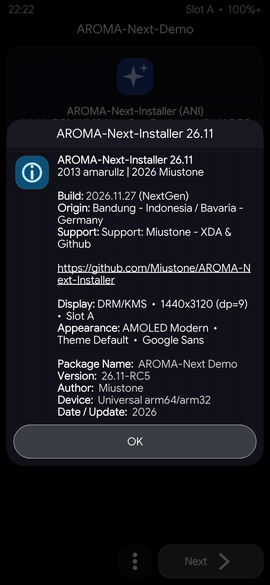
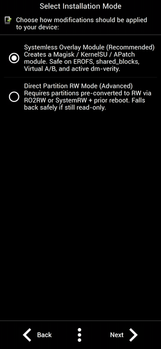
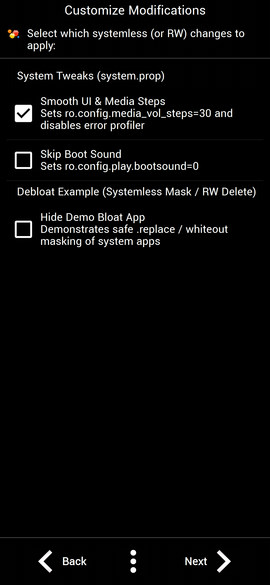
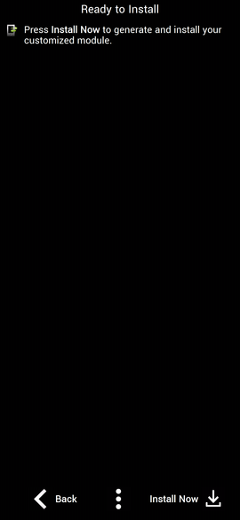
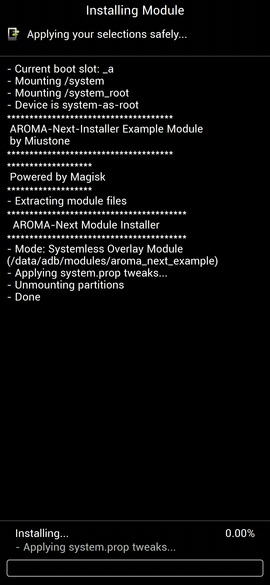

<div align="center">

# AROMA-Next-Installer

**Classic Touch-GUI Android Installer — Rebuilt for Modern `arm64-v8a` & `armeabi-v7a` Devices, Custom Recoveries, and Systemless-First Magisk / KernelSU / APatch Modules**

[](https://github.com/Miustone/AROMA-Next-Installer/actions/workflows/build.yml)
[](https://github.com/Miustone/AROMA-Next-Installer/releases)
[](https://github.com/Miustone/AROMA-Next-Installer/releases)
[](#downloads)
[](README)

[Screenshots](#screenshots) • [Highlights](#highlights) • [Downloads](#downloads) • [Systemless Modding](#systemless-first-modding--optional-pre-rw) • [Building](#building-from-source) • [Changelog](CHANGELOG.md)

</div>

---

**AROMA-Next-Installer** is a modern `arm64-v8a` + `armeabi-v7a` revival of Ahmad Amarullah's **AROMA Installer** (Apache 2.0). Built from the ground up for contemporary Android smartphones (Android 10–16+), modern custom recoveries (**TWRP**, **OrangeFox**, **AERA Recovery**, **PitchBlack**), and safe **Systemless-First** module packaging (**Magisk**, **KernelSU**, **APatch**).

---

## Screenshots

<p align="center">
  <em>Captured on Google Pixel 7 Pro • OrangeFox R12.0 • Black &amp; White Default Theme — Click any screenshot for full resolution</em>
</p>

<div align="center">
  <table>
    <tr>
      <td align="center">
        <a href="screenshots/01-welcome.png">
          
        </a><br>
        <sub><b>1. Welcome &amp; Root Detection</b></sub>
      </td>
      <td align="center">
        <a href="screenshots/02-theme-switcher.png">
          
        </a><br>
        <sub><b>2. Live Theme Switcher</b></sub>
      </td>
      <td align="center">
        <a href="screenshots/03-about-dialog.png">
          
        </a><br>
        <sub><b>3. About Dialog</b></sub>
      </td>
      <td align="center">
        <a href="screenshots/04-installation-mode.png">
          
        </a><br>
        <sub><b>4. Installation Mode</b></sub>
      </td>
    </tr>
  </table>
  <table>
    <tr>
      <td align="center">
        <a href="screenshots/05-customize-modifications.png">
          
        </a><br>
        <sub><b>5. Customize Modifications</b></sub>
      </td>
      <td align="center">
        <a href="screenshots/06-ready-to-install.png">
          
        </a><br>
        <sub><b>6. Ready to Install</b></sub>
      </td>
      <td align="center">
        <a href="screenshots/07-installing-progress.png">
          
        </a><br>
        <sub><b>7. Live Install Progress</b></sub>
      </td>
    </tr>
  </table>
</div>

---

## Highlights

- **Modern Display Backends (`DRM/KMS` + `fbdev`):** Pure Linux kernel ioctl **Atomic KMS** double-buffered dumb-buffer engine (zero `libdrm.so` dependency) supporting inherited recovery DRM master FDs, Exynos/Google Tensor panels (`RGBA8888`), **Qualcomm `msm_drm` Dual-LM Source-Split (AERA Recovery)**, legacy `SETCRTC` + `DIRTYFB`, and `fbdev` fallback.
- **Broad Custom Recovery Support (incl. AERA Recovery):** Works across **TWRP**, **OrangeFox**, **PitchBlack**, and **AERA Recovery** — including high file descriptor (`OUTFD >= 10`) pipe handling and full primary/overlay plane restoration added in **[`V26.11-RC2-PRE2`](CHANGELOG.md#v2611-rc2-pre2--2026-11-20-pre-release)** *(2026-11-20 Pre-Release)*.
- **Zero-Freeze Recovery Safety (`EXIT 77`):** Cleanly pauses/resumes ancestor recovery processes and restores original scanout planes before exit. If a recovery holds an unshared display lock, AROMA-Next exits with code `77` (`AROMA_EXIT_NO_DISPLAY`) and automatically runs the non-GUI fallback instead of hanging.
- **High-Hz OLED Touch & Hardware Keys:** Scans up to 64 input devices (`/dev/input/event0..63`), supports Linux Multitouch Protocol Type-B (`ABS_MT_SLOT`), includes LED vibrator haptic fallback, and suppresses accidental key actions during `Vol-Down + Power` screenshots (with shutter flash feedback).
- **Live Theme Switcher & OLED Default Theme:** Ships with Miustone's crisp **Black & White** default theme and lets users switch themes live via **3-Dot Menu → Select Theme** (*Black & White, ICS, MIUI 4, MIUI, Touchwiz, Franzyroy, Generic*) without restarting or losing selections.
- **Flash Anywhere (Recovery or Root App):** Runs the full Touch GUI inside custom recoveries (`BOOTMODE=false`) and automatically falls back to headless module installation when flashed inside the **Magisk**, **KernelSU**, or **APatch** app (`BOOTMODE=true`).

---

## Downloads

Prebuilt flashable ZIPs and standalone static ELF binaries are built automatically via GitHub Actions and published on the [**Releases**](https://github.com/Miustone/AROMA-Next-Installer/releases) page:

| Package | Description |
| :--- | :--- |
| **`AROMA-Next-Installer.zip`** | Universal recovery demo & test ZIP (`arm64-v8a` + `armeabi-v7a` Touch GUI) |
| **`AROMA-Next-Magisk-Template.zip`** | Ready-to-use Magisk / KernelSU / APatch module template with Recovery Touch GUI, App-mode fallback, `aroma-env-check.sh`, and `aroma-mod-lib.sh` |
| **`aroma_installer-arm64`** / **`aroma_installer-arm32`** | Standalone static ELF binaries for custom integration |

### Supported & Verified Recoveries / Devices

| Device | Recovery | Display Backend | Supported Since |
| :--- | :--- | :--- | :--- |
| **Google Pixel 7 Pro** (`cheetah`, Android 16) | OrangeFox R12.0 | `exynos-drm` (Atomic KMS) | `V26.11-RC1` (2026-11-19) |
| **OnePlus 15** *(+ other Qualcomm `msm_drm` devices)* | **AERA Recovery** | Qualcomm `msm_drm` (Dual-LM Source-Split + High-FD `OUTFD >= 10`) | [`V26.11-RC2-PRE2`](CHANGELOG.md#v2611-rc2-pre2--2026-11-20-pre-release) *(2026-11-20 Pre-Release)* |

> **AERA Recovery Support (`V26.11-RC2-PRE2` — 2026-11-20 Pre-Release):** Includes Qualcomm `msm_drm` Dual-LM Source-Split Atomic KMS plane prioritization, pixel-format validation, full primary + overlay plane restoration on exit, and `/proc/self/fd/$OUTFD` high-FD pipe compatibility.
>
> Have you tested AROMA-Next on another device or recovery? Feedback and `/tmp/recovery.log` reports are always welcome via GitHub Issues!

---

## Systemless-First Modding + Optional Pre-RW

On modern Android (10–16+), `/system`, `/vendor`, `/product`, and `/system_ext` typically use **EROFS** (read-only by kernel design) or deduplicated `shared_blocks` `ext4` inside dynamic `super` partitions protected by `dm-verity`.

**AROMA-Next** brings back classic Touch-GUI file modding safely in two modes:

1. **Systemless Overlay Mode (Default & Recommended):**
   - Generates a standard Magisk / KernelSU / APatch module (`$MODPATH`, or directly `/data/adb/modules/<id>` when flashed in Recovery).
   - Works on **EROFS**, `shared_blocks` `ext4`, Virtual A/B, and active `dm-verity` with zero bootloop risk.
2. **Direct Partition RW Mode (Optional for Power Users):**
   - Intended **only** if you already converted your partitions to RW beforehand using an external tool like **RO2RW** or **SystemRW** and rebooted prior to running AROMA-Next.
   - `aroma_probe_rw()` verifies actual partition writability before touching anything; if partitions are still EROFS or locked RO, it safely falls back to Systemless Mode (or aborts cleanly).

### Dual-Mode Flow (`Recovery` vs. `App`)

- **In Recovery (`TWRP` / `OrangeFox` / `AERA`, `BOOTMODE=false`):** `update-binary` detects `uname -m` (`aarch64` / `armv7l`), launches the Touch GUI (`aroma-config`), writes user choices to `/tmp/aroma/*.prop`, and calls `magisk-installer` → `customize.sh`.
- **In Magisk / KernelSU / APatch App (`BOOTMODE=true`):** Android's SurfaceFlinger owns the display, so `update-binary` skips the recovery Touch GUI and runs `magisk-installer` → `customize.sh` directly using safe Systemless defaults.

### Developer Quickstart (`aroma-mod-lib.sh`)

Use `magisk-template/` as your starting point (`module.prop`, `customize.sh`, `META-INF/com/google/android/aroma-config`). Inside `customize.sh`, source `aroma-mod-lib.sh` and use these helpers:

```sh
# 1. Initialize backend ("systemless", "rw", or "auto"; 3rd arg = fallback to systemless 1|0)
aroma_mod_init "$REQ_MODE" "$MODPATH" 1

# 2. Set/override build.prop entries (writes $MODPATH/system.prop in Systemless mode)
aroma_mod_edit_prop "ro.config.media_vol_steps" "30"

# 3. Copy/replace files into system, vendor, product, system_ext, or odm
aroma_mod_copy "$MODPATH/files/custom_config.example" "system/etc/custom_config.conf" 0644

# 4. Debloat / delete apps or files (.replace / KernelSU 0:0 whiteouts in Systemless mode)
aroma_mod_delete "system/app/ExampleBloat" "dir"
aroma_mod_delete "system/media/bootanimation.zip" "file"

# 5. Patch an existing read-only system file inside the overlay module
aroma_mod_patch_file "system/etc/hosts" "s/old_entry/new_entry/"
```

---

## Technical Architecture

<details>
<summary><b>Why Legacy AROMA Broke &amp; Under-the-Hood Improvements (Click to expand)</b></summary>

1. **64-bit (`arm64-v8a`) & C11 Cleanliness:**
   - Fixed 64-bit pointer truncation (`uintptr_t` in `src/libs/aroma_memory.c`, `intptr_t` casts in `src/libs/aroma_graph.c` and `libs/minzip/Zip.c`), `sizeof(AARRAY_ITEM)` allocation & `NULL`-key checks in `src/libs/aroma_array.c`, `0755` permissions in `src/libs/aroma_zip.c`, `fabs()` in `src/libs/aroma_libs.c`, ARM64 NEON blitter alpha init in `src/libs/neon/blt_neon.c`, and C11 inline linkage in `libs/minzip/inline_magic.h`.
   - Updated `Android.mk` + added `Application.mk` (`APP_PLATFORM := android-35`) for Android NDK r27c (`arm64-v8a` + `armeabi-v7a`).

2. **Dual Display Engine (`fbdev` + Pure-ioctl `DRM/KMS` + Atomic KMS):**
   - Added `src/libs/graph_drm.c`: pure Linux kernel ioctl DRM/KMS dumb-buffer backend (`/dev/dri/card0..3`) with **inherited DRM master FD detection** (`/proc/self/fd`), **Atomic KMS** double-buffering & overlay plane management (`DRM_IOCTL_MODE_ATOMIC`), **Qualcomm `msm_drm` Dual-LM Source-Split** plane selection & full property restoration before `RMFB` (prevents `-EINVAL` black screen / UI freezes on return to recovery), Exynos/Google Tensor byte-order handling (`RGBA8888`), legacy `SETCRTC` + `DIRTYFB` fallback, and zero external `libdrm.so` dependency.
   - Enhanced `fbdev` in `src/libs/aroma_graph.c`: tries `/dev/graphics/fb0` and `/dev/fb0`, validates `mmap != MAP_FAILED`, and reads real `red/green/blue/transp` channel offsets from `FBIOGET_VSCREENINFO`.
   - **Anti-Freeze Recovery Safety (`EXIT 77`):** If neither `fbdev` nor DRM master can be acquired, AROMA-Next immediately resumes the parent recovery (`SIGCONT`) and exits with code `77` (`AROMA_EXIT_NO_DISPLAY`) so the dispatcher runs the non-GUI fallback instead of hanging recovery.
   - **Process Hierarchy Pause (`src/main/aroma.c`):** Walks ancestor PIDs up to `recovery`/`twrp` so both shell dispatchers (`update-binary`) and the recovery compositor stay paused during Touch GUI execution and resume cleanly in reverse order.

3. **Modern Touch, Input & Recovery Pipe Compatibility:**
   - Raised `INDR_MAXDEV` from `15` to `64` so touchscreens on `/dev/input/event15+` are detected.
   - Added Linux Multitouch Protocol Type-B (`ABS_MT_SLOT`) filtering so secondary fingers don't corrupt slot-0 coordinates.
   - Replaced shared `static` touch globals with per-device state in `INDR_POS`, added `BTN_TOUCH` up handling, fixed `(1U << 31)` shift, added `ABS_X`/`ABS_Y` calibration fallback, and added `/sys/class/leds/vibrator/{duration,activate}` haptic fallback.
   - High File Descriptor (`OUTFD >= 10`) compatibility via `/proc/self/fd/$OUTFD` in `update-binary` and `magisk-installer`, plus dynamic `mount`/`umount` lookup in `src/main/aroma_ui.c`.

</details>

---

## Building from Source

### Option 1: GitHub Actions (Automatic Releases)
Push to `main`/`master` (updates the `latest` pre-release) or push a tag `v*` / `V*` (creates a versioned GitHub Release; tags containing `-PRE` or `-TEST` are automatically marked as pre-releases) using [`.github/workflows/build.yml`](.github/workflows/build.yml) with Android NDK r27c.

### Option 2: Local Android NDK
```sh
ndk-build NDK_PROJECT_PATH=. APP_BUILD_SCRIPT=Android.mk NDK_APPLICATION_MK=Application.mk -j4
```

### Option 3: Local Cross-Compile with Zig (`zig cc`)
```sh
python build.py --arch arm64 arm32
```
Outputs static binaries to `out/bin/` and flashable ZIPs to `dist/AROMA-Next-Installer.zip` and `dist/AROMA-Next-Magisk-Template.zip`.

---

## License & Credits

Licensed under the **Apache License 2.0** (see [README](README)). See [CHANGELOG.md](CHANGELOG.md) for the full release history.

- **2013** Ahmad Amarullah (`amarullz`) — Original AROMA Installer ([amarullz/AROMA-Installer](https://github.com/amarullz/AROMA-Installer))
- **2026** Miustone (`AROMA-Next-Installer`) — Support: Miustone (XDA & GitHub: [Miustone/AROMA-Next-Installer](https://github.com/Miustone/AROMA-Next-Installer))
