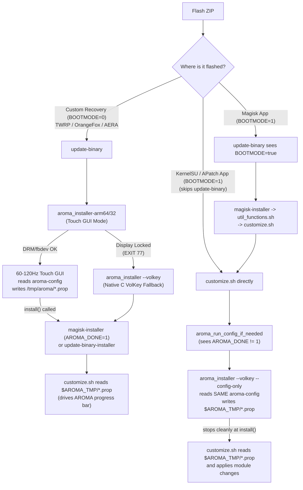

# AROMA-Next-Installer (`ANI`) & Filemanager (`ANF`) — Wiki & Developer Guide

Welcome to the complete technical reference and developer manual for **[AROMA-Next-Installer (`ANI`)](https://github.com/Miustone/AROMA-Next-Installer)** — the modern 64-bit (`arm64-v8a` + `armeabi-v7a`) Material 3 You Touch-GUI Installer, Native `BOOTMODE=1` Volume Key Engine, and Integrated **AROMA-Next-Filemanager (`ANF`)** & Recovery Toolkit for Android 10–16+.

> **Abbreviations:** **`ANI`** = **AROMA-Next-Installer** | **`ANF`** = **AROMA-Next-Filemanager**.
> **Companion Repositories:** **[AROMA-Next-AnyKernel3](https://github.com/Miustone/AROMA-Next-AnyKernel3)** (Custom Kernel Template) • **[aroma-next-action](https://github.com/Miustone/aroma-next-action)** (Reusable GitHub Action CI Packager).

---

## Table of Contents

1. [Architecture & Core Concepts](#1-architecture--core-concepts)
2. [The 4 Official ZIP Packages](#2-the-4-official-zip-packages)
3. [Dual-Mode Engine: `BOOTMODE=0` vs. `BOOTMODE=1` & `EXIT 77`](#3-dual-mode-engine-bootmode0-vs-bootmode1--exit-77)
4. [Complete `aroma-config` (Edify) Reference](#4-complete-aroma-config-edify-reference)
5. [Building Magisk / KernelSU / APatch Modules (Single Config, Zero MMT-Extended)](#5-building-magisk--kernelsu--apatch-modules-single-config-zero-mmt-extended)
6. [Systemless-First Modding & Optional Direct RW Mode](#6-systemless-first-modding--optional-direct-rw-mode)
7. [Building Custom ROMs, Kernels & Traditional Flashable Mods](#7-building-custom-roms-kernels--traditional-flashable-mods)
8. [AROMA-Next-Filemanager & Root Module Manager](#8-aroma-next-filemanager--root-module-manager)
9. [Themes, Fonts, Transitions, UTF-8 & Screenshots](#9-themes-fonts-transitions-utf-8--screenshots)
10. [Building from Source, Packaging & CLI Testing](#10-building-from-source-packaging--cli-testing)
11. [Troubleshooting & Best Practices](#11-troubleshooting--best-practices)

---

## 1. Architecture & Core Concepts

**AROMA-Next-Installer** revives Ahmad Amarullah's classic AROMA Installer for modern Android devices while solving every architectural barrier introduced since Android 10:

- **Pure Static Native Binaries (`arm64-v8a` + `armeabi-v7a`):** Zero shared-library dependencies (`libdrm.so`, `libc++`, etc. are not required). Built with Android NDK r27c or `zig cc` (`aarch64-linux-musl` / `arm-linux-musleabihf`).
- **Dual Display Engine (`DRM/KMS` + `fbdev`):** Pure kernel ioctl Atomic KMS ping-pong double buffering with ARM NEON RGB565→RGBA blitting, Exynos/Google Tensor (`RGBA8888`) support, Qualcomm `msm_drm` Dual-LM Source-Split (AERA Recovery), legacy `SETCRTC`/`DIRTYFB`, and classic `fbdev` fallback.
- **High-Hz OLED Touch & Input:** Scans `/dev/input/event0..63`, handles Linux Multitouch Protocol Type-B (`ABS_MT_SLOT`), suppresses stray clicks during `Vol-Down + Power` screenshots, and protects ancestor recovery processes with async-signal-safe `SIGCONT` crash guards.
- **Single-Source Dual-Mode Configuration:** Authors write **one** `META-INF/com/google/android/aroma-config`. AROMA-Next automatically renders it as:
  - A **60–120Hz Touch GUI** in Custom Recovery (`BOOTMODE=0`), and
  - A **Native C Volume Key Selector** inside Magisk, KernelSU, and APatch apps (`BOOTMODE=1`) or on recoveries with locked display (`EXIT 77`).

### ZIP Directory Layout

```text
YourPackage.zip
├── META-INF/com/google/android/
│   ├── update-binary                 # Universal multi-arch & BOOTMODE dispatcher
│   ├── aroma-config                  # Your single UI & workflow script (Edify)
│   ├── magisk-installer              # Module bridge (Magisk + standalone KSU/APatch Recovery)
│   ├── aroma-mod-lib.sh              # Shell helper API (aroma_run_config_if_needed, systemless/RW)
│   ├── aroma-env-check.sh            # Optional recovery environment probe
│   ├── updater-script                # For ROM/Mod zips (or '#MAGISK' for modules)
│   ├── update-binary-installer       # ONLY for traditional ROM/Edify zips (omit for Magisk modules!)
│   ├── bin/
│   │   ├── aroma_installer-arm64     # Static 64-bit AROMA-Next engine
│   │   └── aroma_installer-arm32     # Static 32-bit AROMA-Next engine
│   └── aroma/
│       ├── icons/                    # Built-in UI icons (@welcome, @install, @customize, ...)
│       ├── langs/                    # Built-in localizations (en, de, ru, cn, es, fr, it, ja, he, id)
│       ├── splash/                   # HiDPI nostalgia splash frames (a1..a6.png)
│       ├── themes/                   # 6 bundled themes (blacknwhite, ics, miui, miui4, touchwiz, franzyroy)
│       └── ttf/                      # 7 SIL OFL fonts (Google Sans default) + DroidSansFallback.ttf
├── module.prop                       # (For Magisk / KernelSU / APatch modules)
├── customize.sh                      # (For Magisk / KernelSU / APatch modules)
└── system/                           # (Your module or ROM payload)
```

> **Important Rule for `install()` Backend Selection:**
> When `aroma-config` executes `install(...)`, the engine checks `META-INF/com/google/android/update-binary-installer` first, and if absent, falls back to `META-INF/com/google/android/magisk-installer`.
> - **Magisk / KernelSU / APatch Modules:** **Omit** `update-binary-installer` and include `magisk-installer`.
> - **ROMs / Legacy Edify ZIPs:** Include `update-binary-installer` + `updater-script`.

---

## 2. The 4 Official ZIP Packages

| Package | Target Audience | Purpose |
| :--- | :--- | :--- |
| **`AROMA-Next-Installer.zip`** | ROM, Kernel & Mod Developers | Clean `ANI` base template with HiDPI splash, **AMOLED Modern** (Monochrome White) + Google Sans default, Hero Welcome card, quick `ANF` entry, and safe sample `updater-script`. |
| **`AROMA-Next-Magisk-Template.zip`** | Magisk / KernelSU / APatch Authors | Ready-to-use Dual-Mode module template (`BOOTMODE=0` Touch GUI + `BOOTMODE=1` native Volume Key Selector), `aroma-mod-lib.sh`, `aroma-env-check.sh`, and `magisk-installer`. |
| **`AROMA-Next-Filemanager.zip`** | End Users & Power Users | Standalone **`ANF`** recovery tool booting straight into the 4-tab Filemanager, Root Module Manager, Bootloop-Saver, ZIP Inspector, Quick Reboot & Diagnostics toolkit. |
| **`AROMA-Next-Demo.zip`** | Testers & Evaluators | Interactive showcase of every `ANI` widget (`slider(...)`, `live_appearance(...)`, checkboxes, forms, menubox), all 8 themes, 8 live accents, 7 fonts, 5 transitions, UTF-8 multilanguage, `ANF`, and simulated install progress. |

---

## 3. Dual-Mode Engine: `BOOTMODE=0` vs. `BOOTMODE=1` & `EXIT 77`

One of the biggest pain points in Android modding has always been maintaining **two separate installers** — an AROMA Touch GUI for Recovery and a bash Volume Key script (like MMT-Extended) for Magisk/KernelSU/APatch apps.

**AROMA-Next solves this natively inside the C engine (`src/main/aroma_volkey.c`).**

### Execution Flow Across Every Environment



### Key Technical Differences Between `BOOTMODE=0` and `BOOTMODE=1`

| Aspect | Recovery Touch GUI (`BOOTMODE=0`) | Android App VolKey Mode (`BOOTMODE=1`) |
| :--- | :--- | :--- |
| **Display Ownership** | Recovery releases/shares DRM master or `fbdev`; AROMA pauses ancestor `recovery`/`twrp` (`SIGSTOP`) and renders directly at 60–120Hz. | Android `SurfaceFlinger` owns the display permanently. AROMA skips `ag_init()` and never sends `SIGSTOP` to Android processes. |
| **Input Method** | Full touchscreen (`ABS_MT_SLOT` Type-B) + hardware keys + `Vol-Down + Power` screenshots. | Pure Linux `/dev/input/event0..63` `KEY_VOLUMEUP` / `KEY_VOLUMEDOWN` (120ms debounce, zero `EVIOCGRAB`). |
| **Output Channel** | Visual framebuffer UI + progress pipe to Recovery `OUTFD`. | Clean 48-column UTF-8 word-wrapped text via Magisk `OUTFD` (`ui_print`) or direct `stdout` (`--plain` in KernelSU/APatch). |
| **Temp Directory (`AROMA_TMP`)** | `/tmp/aroma` (with `/tmp/aroma-data` symlink). | `/dev/tmp/aroma` or `$TMPDIR/aroma` (since booted Android 10–16 lacks a writable `/tmp`). |
| **Shell in `exec()`** | `/sbin/sh` (or whatever binary you pass). | Automatically falls back `/sbin/sh` → `/system/bin/sh` if `/sbin/sh` doesn't exist, and rewrites `/tmp/aroma/...` arguments to runtime `$AROMA_TMP/...`! |
| **Environment Variable** | `AROMA_VOLKEY=0`, `AROMA_DONE=1` (inside `install()`). | `AROMA_VOLKEY=1`, `AROMA_DONE=1` (after `aroma_run_config_if_needed`). |
| **Filemanager** | Full 4-tab Touch Filemanager & Module Manager. | Gracefully reports Touch GUI required (or hide the menu item when `AROMA_VOLKEY=1`!). |
| **Reboot** | Optional `checkviewbox` + `reboot("onfinish");`. | Skipped cleanly (`--config-only` exits at `install()`; Magisk/KSU/APatch app provides the Reboot button). |

### Binary CLI Flags & Environment Variables

```sh
# Standard Recovery Touch GUI (returns 77 if display cannot be acquired)
aroma_installer-arm64 <api> <outfd> <zipfile>

# Full Volume Key Mode (runs aroma-config + executes install() backend)
aroma_installer-arm64 --volkey <api> <outfd> <zipfile>

# Config-Only Volume Key Mode (runs aroma-config up to install(), preserves $AROMA_TMP/*.prop)
aroma_installer-arm64 --volkey --config-only <api> <outfd> <zipfile>

# Plain stdout output (for KernelSU / APatch / ADB testing instead of recovery ui_print pipe)
aroma_installer-arm64 --volkey --config-only --plain 3 1 <zipfile>
```

| Environment Variable | Effect |
| :--- | :--- |
| `AROMA_TMP` | Overrides the runtime temp directory where `.prop`, `.var`, and extracted helper scripts live. |
| `AROMA_VOLKEY` | Set automatically by AROMA (`1` in Volume Key Mode, `0` in Touch GUI) and passed to all `exec()` scripts. Can also force VolKey mode when pre-set to `1`. |
| `AROMA_CONFIG_ONLY` | Equivalent to `--config-only` when set to `1`. |
| `AROMA_PLAIN` | Equivalent to `--plain` when set to `1`. |
| `AROMA_DONE` | Exported as `1` after configuration completes so `aroma_run_config_if_needed` never prompts twice. |
| `AROMA_VK_STDIN` | Set to `1` for automated/headless testing via `stdin` (`+`/`u`/`1` = Vol+, `-`/`d`/`2`/`Enter` = Vol-). |

---

## 4. Complete `aroma-config` (Edify) Reference

### Metadata, Splash, Fonts & Themes

```edify
ini_set("rom_name",    "My Awesome Mod");
ini_set("rom_version", "1.0");
ini_set("rom_author",  "YourName");
ini_set("rom_device",  "Universal arm64/arm32");
ini_set("rom_date",    "2026");

# Animated HiDPI splash (no-op in BOOTMODE=1 VolKey mode)
anisplash(
    2,
    "splash/a1", 400,
    "splash/a2", 30,
    "splash/a3", 30,
    "splash/a4", 30,
    "splash/a5", 30,
    "splash/a6", 30
);

# Typography (0 = body size 12, 1 = title size 14)
fontresload("0", "ttf/GoogleSans-Regular.ttf;ttf/Roboto-Regular.ttf;ttf/DroidSansFallback.ttf;", "12");
fontresload("1", "ttf/GoogleSans-Regular.ttf;ttf/Roboto-Regular.ttf;ttf/DroidSansFallback.ttf;", "14");

# Theme & Transition ("fade" default, "slide", "stack", "zoom", "none")
theme("blacknwhite");
ini_set("transition", "fade");
```

### Rich-Text Formatting Tags
Supported in all Touch GUI screens (and automatically stripped cleanly in `BOOTMODE=1` Volume Key mode):
- `<b>Bold</b>`, `<i>Italic</i>`, `<u>Underline</u>`
- `<#RRGGBB>Custom hex color</#>`, `<#selectbg_g>Theme accent color</#>`
- `<@center>Centered text</@>`, `<*>Bullet item</*>`

### Built-in Icons
`@welcome`, `@install`, `@installbutton`, `@customize`, `@personalize`, `@apps`, `@info`, `@alert`, `@confirm`, `@update`, `@license`, `@agreement`, `@default`, `@next`, `@back`, `@finish`, `@menu`.

### UI Widgets & `.prop` Output Formats

#### 1. `viewbox` & `checkviewbox`
```edify
viewbox("Title", "Rich-text body...", "@welcome");

checkviewbox(
    "Finished",
    "All done!",
    "@welcome",
    "Reboot device now",   # Checkbox label
    "0",                   # Initial state ("0" or "1")
    "reboot_it"            # Saved into Edify var (read via getvar("reboot_it"))
);
```
- **VolKey behavior:** `viewbox` prompts `[VOL+] Next | [VOL-] Back`; `checkviewbox` prompts `[VOL+] Yes | [VOL-] No`.

#### 2. `menubox` (Single-Tap Action Menu)
```edify
menubox(
    "Setup Mode",
    "Choose an action:",
    "@customize",
    "mode.prop",
    "Custom Setup",    "Configure every option", "@personalize",   # selected=1
    "Recommended",     "Instant 1-tap preset",   "@install",       # selected=2
    "Open Filemanager","Manage modules & files", "@apps"           # selected=3
);
```
- **Output (`mode.prop`):** `selected=1` (1-based index).
- **VolKey behavior:** `[VOL+] Next option | [VOL-] Select`.

#### 3. `selectbox` (Radio Buttons — Grouped or Ungrouped)
```edify
selectbox(
    "Install Mode",
    "Select one option per group:",
    "@install",
    "sel.prop",
    "Group Header", "", 2,               # 2 = Group header (group 1)
      "Option A", "Description A", 1,    # 1 = Default selected (selected.1=1)
      "Option B", "Description B", 0     # 0 = Unselected       (selected.1=2)
);
```
- **Output (`sel.prop`):** `selected.0=<idx>` (ungrouped) or `selected.<group>=<idx>` (grouped). Value `3` hides an item.
- **VolKey behavior:** Cycles per group with `[VOL+]`, confirms with `[VOL-]`.

#### 4. `checkbox` (Grouped Multi-Select Checkboxes)
```edify
checkbox(
    "Select Features",
    "Toggle components:",
    "@customize",
    "features.prop",
    "Core Tweaks", "", 2,                    # Group 1
      "Feature One", "Enables X", 1,         # item.1.1=1 (default ON)
      "Feature Two", "Enables Y", 0          # item.1.2=0 (default OFF)
);
```
- **Output (`features.prop`):** `item.<group>.<index>=1` or `0`.
- **VolKey behavior:** Walks each item with `[VOL+] Enable (ON) | [VOL-] Disable (OFF)`.

#### 5. `form` (Hybrid Radio Groups + Checkboxes with Named Keys — Recommended!)
```edify
form(
    "Audio Settings",
    "Mix radio groups and checkboxes on a single scrollable screen:",
    "@personalize",
    "audio.prop",
    # PROP_ID       TITLE                  SUBTITLE                     TYPE
    "samplerate",  "Output Sample Rate",   "",                          "group",
      "48000",     "48 kHz",               "Android standard",          "select",
      "96000",     "96 kHz [Recommended]", "Native Hi-Res",             "select.selected",
    "extras",      "Extra Tweaks",         "",                          "group",
      "drc_off",   "Disable DRC",          "Restores natural dynamics", "check.checked",
      "bt_hd",     "Bluetooth SBC HD",     "High bitrate dual-channel", "check"
);
```
- **Output (`audio.prop`):** Clean named key-value pairs!
  ```ini
  samplerate=96000
  drc_off=1
  bt_hd=0
  ```
- **Types:** `"group"`, `"select"`, `"select.selected"`, `"check"`, `"check.checked"`, `"hide"`.
- **VolKey behavior:** Renders each radio group as a `[VOL+] Next | [VOL-] Select` list and each checkbox as `[VOL+] Enable | [VOL-] Disable`, writing the **exact same named keys**!

#### 6. `slider` (Interactive Range Slider — Touch GUI + Volume Key Stepper!) *(New in RC5)*
```edify
slider(
    "ZRAM Swap Size",
    "Drag the slider or tap - / + to tune ZRAM capacity:",
    "@customize",
    "tuning.prop",   # Output .prop file inside $AROMA_TMP (preserves other keys!)
    "zram_mb",       # Key name written to tuning.prop
    "512",           # Minimum value (integer)
    "8192",          # Maximum value (integer)
    "512",           # Step increment (integer >= 1)
    "4096",          # Default value (integer)
    "MB"             # Optional unit suffix (10th argument)
);
```
- **Output (`tuning.prop`):** Writes `zram_mb=4096` (preserving any other keys in `tuning.prop`, so you can place multiple `slider(...)` screens into one `.prop` file!) and also returns the chosen value as a string (`"4096"`).
- **Touch GUI (`BOOTMODE=0`):** Renders an elevated card with live value readout, draggable accent-filled track, tactile thumb knob, and `[- step]` / `[+ step]` fine-tune buttons. Restores the saved value automatically if the user presses Back.
- **VolKey behavior (`BOOTMODE=1`):** Renders an ASCII progress bar `[########--------] 4096 MB` with `[VOL+] +Step | [VOL-] Confirm | [Hold VOL-] Back`.

#### 7. Built-in Mode Detection, Live Accents, Dialogs & Flow Control
- `is_volkey()` → returns `"1"` in `BOOTMODE=1` Volume Key mode, `"0"` in Touch GUI mode! (No external shell probe needed!)
- `ini_get("volkey")` / `ini_get("theme")` / `ini_get("accent")` / `ini_get("slot")` (`"_a"`, `"_b"`, or `""`)
- `accent("blue")` / `accent("emerald")` / `accent("violet")` / `accent("crimson")` / `accent("amber")` / `accent("cyan")` / `accent("mono")` / `accent("#FF6D00")` → sets a live Material You accent color (overridable anytime by the user via the 3-dot menu!)
- `textbox(title, desc, ico, text)` / `agreebox(title, desc, ico, text, agree_label, unchk_alert)`
- `alert(title, text [, ico, ok_label])`
- `confirm(title, text [, ico, yes_label, no_label])` → returns `"yes"` or `"no"`
- `textdialog(title, text [, ok_label])`
- `pleasewait(text)` → shows busy overlay (automatically ensures fonts/theme are loaded first!)
- `ziptotmp("META-INF/com/google/android/probe.sh", "probe.sh")` → extracts to `$AROMA_TMP/probe.sh`
- `exec("/sbin/sh", "/tmp/aroma/probe.sh")` → runs script (in `BOOTMODE=1`, auto-maps `/sbin/sh`→`/system/bin/sh` and `/tmp/aroma/`→`$AROMA_TMP/`), saves stdout/stderr to `getvar("exec_buffer")`
- `prop("file.prop", "key")` / `file_getprop("/abs/path", "key")` / `readtmpfile("summary.txt")` / `writetmpfile("out.txt", "data")`
- `setvar("k", "v")` / `getvar("k")` / `appendvar("k", "v")`
- `gotolabel("menu");` + `goto("menu");` / `back("1");`
- `filemanager();` or `filemanager("/data/adb/modules");`
- `install(title, desc, ico [, finish_desc])` → returns backend exit code string (`"0"` on success)
- `reboot("onfinish");`

---

## 5. Building Magisk / KernelSU / APatch Modules (Single Config, Zero MMT-Extended)

Starting from **`AROMA-Next-Magisk-Template.zip`** (or `magisk-template/` in this repository), you do **not** need MMT-Extended or any separate Volume Key shell script.

### Step 1: Write `module.prop`
```ini
id=my_awesome_mod
name=My Awesome Mod
version=v1.0
versionCode=100
author=YourName
description=Configured via AROMA-Next Touch GUI in Recovery and native Volume Key Selector in Android App.
```

### Step 2: Write ONE `META-INF/com/google/android/aroma-config`
Tip: Check `AROMA_VOLKEY` in any startup probe script to adapt wording or hide Recovery-only options (like `filemanager()`) when running in `BOOTMODE=1`!

```sh
# Inside your startup probe script (extracted via ziptotmp + exec):
is_volkey=0
[ "$AROMA_VOLKEY" = "1" ] || [ "$BOOTMODE" = "true" ] || [ "$BOOTMODE" = "1" ] && is_volkey=1
echo "is_volkey=$is_volkey" > "${AROMA_TMP:-/tmp/aroma}/env.prop"
```

### Step 3: Write a Clean `customize.sh`
```sh
SKIPUNZIP=0

# 1. Load AROMA-Next helper library
unzip -qjo "$ZIPFILE" "META-INF/com/google/android/aroma-mod-lib.sh" -d "$TMPDIR" >/dev/null 2>&1
. "$TMPDIR/aroma-mod-lib.sh"

# 2. ONE LINE: In BOOTMODE=1 (Magisk / KernelSU / APatch App), automatically
#    runs your aroma-config through AROMA-Next's native Volume Key Selector!
#    In Recovery (BOOTMODE=0), AROMA Touch GUI already ran so this returns immediately.
aroma_run_config_if_needed

AROMA_PROP_DIR="${AROMA_TMP:-/tmp/aroma}"

read_prop() {
  grep -E "^${2}=" "$AROMA_PROP_DIR/$1" 2>/dev/null | head -n1 | cut -d'=' -f2- | tr -d '\r'
}

# 3. Read choices (identical whether picked via Touch GUI or Volume Keys!)
RATE="$(read_prop audio.prop samplerate)"
DRC_OFF="$(read_prop audio.prop drc_off)"

# 4. Drive AROMA's animated progress bar in Recovery (no-op in App mode)
aroma_progress 0.30 "Applying systemless configuration..."
aroma_mod_init "systemless" "$MODPATH" 1 || abort "Init failed"

[ -n "$RATE" ] && aroma_mod_edit_prop "persist.audio.samplerate" "$RATE"
[ "$DRC_OFF" = "1" ] && aroma_mod_edit_prop "vendor.audio.drc.enable" "false"

# 5. Clean installer helpers from $MODPATH so only clean module payload remains
aroma_progress 0.90 "Cleaning up & setting permissions..."
rm -rf "$MODPATH/META-INF" 2>/dev/null || true
set_perm_recursive "$MODPATH" 0 0 0755 0644
aroma_progress 1.00 "Installation complete!"
```

### Real-World Reference Implementation
See **[Miustone/NLSound (AROMA-Next Edition)](https://github.com/Miustone/NLSound)** — a full real-world port of the 15-option NLSound audio module using **zero MMT-Extended**, live hardware probing, 4-page Touch Wizard + 1-Tap Preset + 1-Tap Profile Restore, automatic `BOOTMODE=1` Volume Key mode, and real-time AROMA progress updates.

---

## 6. Systemless-First Modding & Optional Direct RW Mode

Modern Android (10–16+) uses **EROFS** (kernel-enforced read-only) or `shared_blocks` `ext4` inside dynamic `super` partitions guarded by `dm-verity`.

`aroma-mod-lib.sh` provides a unified API that works safely in **both** modes:

| Helper Function | Systemless Mode (Default & Recommended) | Direct RW Mode (Pre-converted RO2RW/SystemRW only) |
| :--- | :--- | :--- |
| `aroma_mod_init <mode> <modpath> [fallback]` | Initializes `$MODPATH` overlay (`systemless`). | Probes writability via `aroma_probe_rw()`; safely falls back to `systemless` if partition is EROFS/RO and `fallback=1`. |
| `aroma_mod_edit_prop <key> <val>` | Appends/updates `$MODPATH/system.prop`. | Backs up `build.prop` (`.aroma.bak`) and edits in place. |
| `aroma_mod_copy <src> <rel_dst> [mode]` | Copies into `$MODPATH/system/...` (normalizing `vendor/`, `product/`, `system_ext/`, `odm/`). | Backs up target and copies directly onto the live partition. |
| `aroma_mod_delete <rel_dst> [dir\|file\|auto]` | Creates `.replace` (Magisk) or `mknod c 0 0` whiteout (KernelSU / APatch). | Deletes target directly from the RW partition. |
| `aroma_mod_patch_file <rel_dst> <sed_expr>` | Copies read-only stock file into `$MODPATH/...` and runs `sed -i`. | Backs up target and runs `sed -i` live. |
| `aroma_progress <0.0..1.0> <header>` | Sends `set_progress` and `ui_print @Header` to AROMA-Next Touch GUI. | Same. |

---

## 7. Building Custom ROMs, Kernels & Traditional Flashable Mods

Start from **`AROMA-Next-Installer.zip`** (which includes `update-binary-installer` and `updater-script` instead of `magisk-installer`):

1. Place your ROM/Kernel installer binary at `META-INF/com/google/android/update-binary-installer` (can be an `arm64`/`arm32` `update-binary` ELF or shell script!).
2. Place your Edify script at `META-INF/com/google/android/updater-script` (or handle flashing inside your shell `update-binary-installer`).
3. Customize `META-INF/com/google/android/aroma-config` to ask for kernel variant, GApps, debloat list, etc.
4. Read the user's choices from `/tmp/aroma/*.prop` inside `updater-script` (via `file_getprop("/tmp/aroma/customize.prop", "item.1.1")`) or inside your shell installer!
5. Drive AROMA's live progress bar & section titles from your backend installer:
   ```sh
   # Write to /proc/self/fd/$OUTFD (works even on high FDs >= 10 like AERA Recovery!)
   printf 'set_progress 0.45\n' > "/proc/self/fd/$OUTFD"
   printf 'ui_print @Flashing Kernel & Modules...\nui_print\n' > "/proc/self/fd/$OUTFD"
   printf 'ui_print - Extracting boot.img...\nui_print\n' > "/proc/self/fd/$OUTFD"
   ```
   - Any `ui_print` line prefixed with **`@`** updates the bold accent progress header above the progress bar!
   - When installation finishes, AROMA automatically shows a **Save Logs** button that saves the full timestamped log to `<zipfile>.log.txt`.

---

## 8. AROMA-Next-Filemanager & Root Module Manager

Built directly into the shared AROMA-Next binary (`src/main/aroma_filemanager.c`), with zero duplicate code.

### 3 Ways to Launch It
1. **From any AROMA-Next installer:** Tap the **3-Dot Menu → `Filemanager`** at any screen (returns straight back to your wizard step without losing selections!).
2. **Standalone ZIP:** Flash **`AROMA-Next-Filemanager.zip`** directly in Recovery.
3. **From `aroma-config`:** Call `filemanager();` or `filemanager("/data/adb/modules");`.

### The 4 Unified Top Tabs

| Tab | Default Path | Capabilities |
| :--- | :--- | :--- |
| **`Modules`** | `/data/adb/modules` | Lists all Magisk, KernelSU, and APatch modules with `module.prop` metadata and live status badges (`ACTIVE`, `DISABLED`, `REMOVE PENDING`, `UPDATE PENDING`). One-tap **Enable / Disable** (`disable` flag), **Mark for Removal on Reboot** (`remove` flag), **Delete Module Now**, **Browse Module Files**, **Edit `module.prop`**, and **Edit `system.prop`**. |
| **`Storage`** | `/sdcard` (`/data/media/0`) | Full file browser with recursive **Copy**, **Cut / Move**, **Paste**, **Delete**, **Rename**, **New Folder**, **New Text File**, **`chmod`** (presets & custom octal), **Properties**, hidden `.dotfiles` toggle, plus built-in **ZIP Inspector & Extractor** (tap any `.zip` → *Inspect ZIP Contents* or *Extract ZIP Here*). |
| **`System`** | `/` & mountpoints | Quick navigation across `/`, `/system`, `/system_root`, `/vendor`, `/product`, `/system_ext`, `/odm`, `/data`, `/cache`, `/persist`, `/metadata`, `/tmp` with live `/proc/mounts` **`[RW]` / `[RO]`** + filesystem badges, active A/B Slot readout, and a **`Remount Partition RW`** helper. |
| **`Tools`** | Recovery Utilities | **Bootloop-Saver (1-Tap Disable ALL Modules / Re-Enable ALL Modules)**, **Quick Reboot Menu** (*System, Recovery, Bootloader, Fastbootd*), **Backup `/tmp/recovery.log`**, **Export Hardware Diagnostic Report** (`/sdcard/AROMA-Next-Diagnostics.txt`), hidden files toggle, remount RW, and Go to Path. |

### Built-In Touch Keyboard & Text Line Editor
- Full on-screen **QWERTY keyboard** with lowercase, uppercase, numbers/symbols, and UTF-8 backspace.
- Built-in **Text Viewer & Line Editor** supporting files up to **256 KB / 4,096 lines** with automatic binary-file protection so you never corrupt compiled ELF/DEX/APK files.

---

## 9. Themes, Live Accents, Material 3 Icons, Status Bar & PNG Screenshots

- **Android-Style Top Status Bar:** Displays live **clock** (left of center punch-hole camera) and **Active A/B Slot + Battery %** (right of camera) above the titlebar across both the installer wizard and Filemanager.
- **Material 3 You Icons:** All 17 built-in ANI icons (`@welcome`, `@info`, `@install`, `@apps`, `@personalize`, `@customize`, `@update`, `@alert`, `@confirm`, `@agreement`, `@license`, `@default`, and navigation controls) are redesigned as 4x-supersampled Material 3 tonal squircles & rounded strokes.
- **Streamlined 3-Dot Menu:** **`About` → `Appearance` → `Filemanager` → `Exit` → `Back`**.
- **1-Tap Instant Live Switching (No Extra "OK" Tap):** Tap **`Appearance`** on any screen to switch live with a single tap:
  - **8 Themes:** `AMOLED Modern` *(Pure OLED black + Material You surfaces)*, `Black & White`, `ICS`, `MIUI 4`, `MIUI`, `TouchWiz`, `Franzyroy`, `Generic`.
  - **8 Live Accent Colors:** `Theme Default`, `Pixel Blue`, `Monochrome White`, `Emerald Green`, `Crimson Red`, `Warm Amber`, `Electric Violet`, `Ice Cyan` (plus custom hex via `accent("#RRGGBB");`).
  - **7 SIL OFL Fonts:** `Google Sans` *(Default)*, `Roboto`, `Inter`, `Plus Jakarta Sans`, `Outfit`, `Ubuntu`, `JetBrains Mono` — all backed by `DroidSansFallback.ttf`, FreeType 2.15.0, and RFC 3629 `minutf8`.
  - **5 VSYNC-Locked 60–120Hz Transitions:** `Fade` *(Default)*, `Slide`, `Stack`, `Zoom`, `None`.
- **Lossless PNG Screenshots in Recovery:** Press **`Vol-Down + Power`** on any screen! ANI flashes a thread-safe white shutter frame (`ag_refreshlock`), suppresses accidental touches, and encodes a **lossless 24-bit PNG** (~150–350 KB instead of 9 MB BMP) via `libpng 1.6.59` into `/sdcard/Pictures/AROMA-Next/AROMA-Next-NNN.png` (falling back beside the ZIP if `/sdcard` is encrypted).

### Unattended Preset Mode (`--preset <file>` / `AROMA_PRESET`)
In `BOOTMODE=1` (or automated OTA/CI flashing), pass `--preset /path/to/preset.prop` (or set `AROMA_PRESET=/path/to/preset.prop`) to auto-apply answers without waiting for Volume Key presses:
```ini
# Format: <propfile>:<key>=<value> (or plain <key>=<value> fallback)
demo_hub.prop:selected=1
tuning.prop:zram_mb=4096
checkbox_demo.prop:item.1.1=1
```

---

## 10. Building from Source, Packaging & CLI Testing

### Option 1: Cross-Compile Locally with Zig (`zig cc`)
```sh
python build.py --zig /path/to/zig --arch arm64 arm32
```
Outputs static stripped binaries to `out/bin/` and all 4 ZIPs to `dist/`.

### Option 2: Android NDK (`ndk-build`)
```sh
ndk-build NDK_PROJECT_PATH=. APP_BUILD_SCRIPT=Android.mk NDK_APPLICATION_MK=Application.mk -j$(nproc)
```

### Option 3: Reusable GitHub Action (`Miustone/aroma-next-action@v1`) — Recommended for Module & Kernel Authors
Instead of committing ~5 MB of `aroma_installer-*` binaries and UI assets into your own repository, let **[Miustone/aroma-next-action](https://github.com/Miustone/aroma-next-action)** download the latest official `ANI` release and merge your repository files into a flashable ZIP automatically in GitHub Actions:

```yaml
name: Build Flashable ZIP with ANI
on: [push, release]

jobs:
  package:
    runs-on: ubuntu-latest
    steps:
      - uses: actions/checkout@v4

      - name: Package with AROMA-Next-Installer (ANI)
        id: ani
        uses: Miustone/aroma-next-action@v1
        with:
          source_dir: .
          template: magisk          # magisk | anykernel3 | installer | none
          aroma_version: latest     # or pin e.g. V26.11-RC5
          architectures: arm64,arm32
          output_zip: dist/MyModule-AROMA.zip
          github_token: ${{ secrets.GITHUB_TOKEN }}

      - uses: actions/upload-artifact@v4
        with:
          name: MyModule-AROMA
          path: ${{ steps.ani.outputs.zip_path }}
```

For **AnyKernel3 custom kernels**, start from **[Miustone/AROMA-Next-AnyKernel3](https://github.com/Miustone/AROMA-Next-AnyKernel3)** (Android 10–16+ GKI 2.0 & Non-GKI ready) and set `template: anykernel3` in the Action above!

### Option 4: Building `ANI` Itself via GitHub Actions
Push to `main` (updates rolling `latest` pre-release) or push a version tag `V*` / `v*` (creates a versioned GitHub Release; tags containing `-PRE` or `-TEST` are automatically marked pre-release).

### Automated Testing of `BOOTMODE=1` Volume Key Mode via ADB
You can test any module's `aroma-config` in Volume Key Mode directly from a PC without tapping physical buttons using `AROMA_VK_STDIN=1`:
```sh
adb push YourModule.zip /sdcard/YourModule.zip
adb shell '
  mkdir -p /data/local/tmp/vk
  unzip -o /sdcard/YourModule.zip META-INF/com/google/android/bin/aroma_installer-arm64 -d /data/local/tmp/vk >/dev/null
  chmod 755 /data/local/tmp/vk/META-INF/com/google/android/bin/aroma_installer-arm64
  printf "++-\n" | AROMA_VK_STDIN=1 AROMA_TMP=/data/local/tmp/aroma_test \
    /data/local/tmp/vk/META-INF/com/google/android/bin/aroma_installer-arm64 \
    --volkey --config-only --plain 3 1 /sdcard/YourModule.zip
  cat /data/local/tmp/aroma_test/*.prop
'
```

---

## 11. Troubleshooting & Best Practices

- **Always use LF (`\n`) line endings** for `update-binary`, `magisk-installer`, `customize.sh`, `aroma-config`, and all `.sh`/`.prop` files (`\r\n` breaks BusyBox `ash`!).
- **Set Unix `0755` permissions** in your ZIP on `update-binary`, `magisk-installer`, `bin/aroma_installer-*`, and any bundled binaries (e.g. `system/bin/*`).
- **Write POSIX `sh` / BusyBox `ash`-compatible scripts:** Recovery `/sbin/sh` is usually BusyBox `ash`, which does not support bashisms like `[[ =~ ]]`, `< <(...)` process substitution, `$'\n'`, or `source` (use `.` instead).
- **Use `/proc/self/fd/$OUTFD` for `ui_print`:** Modern recoveries like AERA Recovery allocate `OUTFD >= 10`, where legacy shell `>&$OUTFD` redirection fails.
- **Debugging Recovery issues:** Pull `/tmp/recovery.log` via `adb pull /tmp/recovery.log` — AROMA-Next logs the detected DRM/fbdev backend, input devices, fonts, and any Edify syntax error with exact line and column numbers.
- **Zero-Freeze Safety:** If a recovery locks DRM master exclusively (`EXIT 77`), `update-binary` automatically switches to `--volkey` mode. And if an unexpected fatal signal ever occurs, AROMA-Next's async-signal-safe crash handler immediately sends `SIGCONT` to paused recovery ancestors so your recovery never hangs.

---

*Licensed under the **Apache License 2.0** — Original AROMA Installer (C) 2011–2013 Ahmad Amarullah (`amarullz`) | AROMA-Next-Installer (C) 2026 Miustone.*
